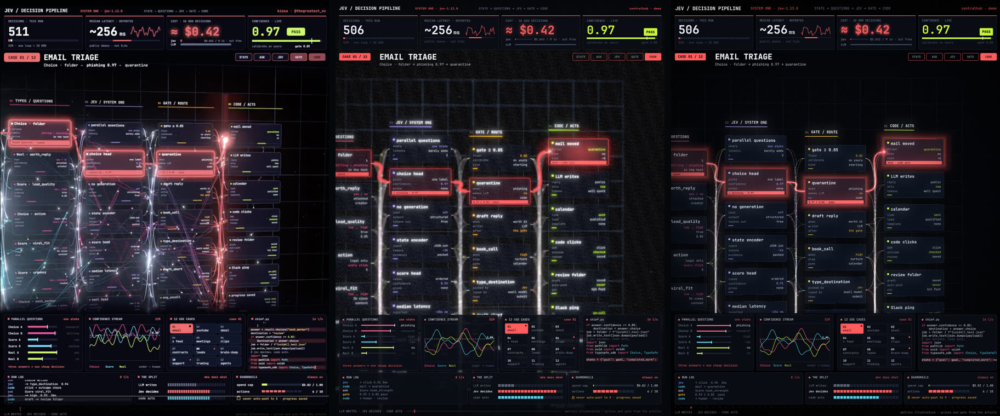
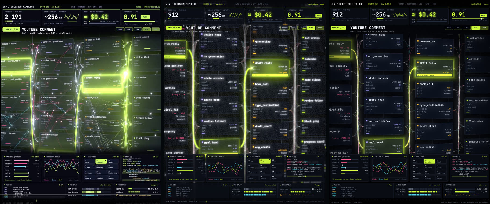
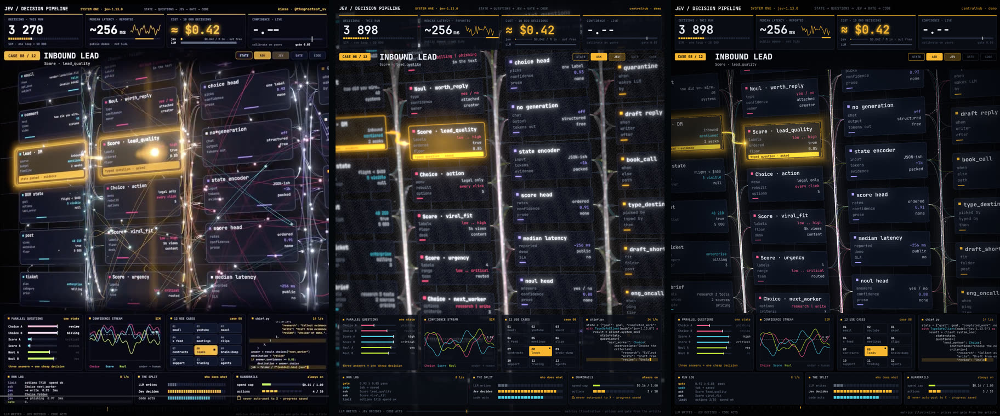
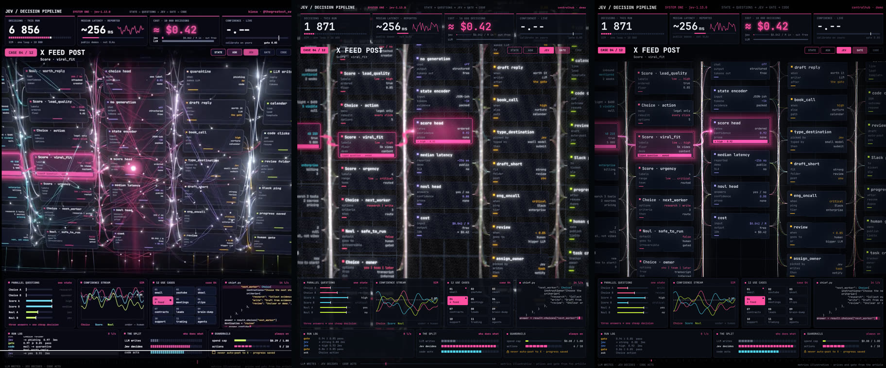

# JEV / Decision Pipeline

Анимированный дашборд-визуализация конвейера принятия решений
**STATE → QUESTIONS → JEV → GATE → CODE**: LLM пишет, Jev решает, код действует.

## Структура

| Папка | Что внутри |
|------|------------|
| [`SPEC.md`](SPEC.md) | спецификация (шаг 2 пайплайна), источник истины для обоих вариантов |
| [`react/`](react/) | вариант 1: Vite + TypeScript + React Three Fiber |
| [`go/`](go/) | вариант 2: Go + Ebitengine (десктоп + WebAssembly) |
| [`shared/`](shared/) | общий контракт: данные 12 кейсов, эталон симуляции, тест-векторы, шрифты |
| [`references/`](references/) | скриншоты-референсы |
| [`report/`](report/) | сравнение кадров: референс, React, Go |

## Быстрый старт

| Вариант | Запуск | Тесты |
|---|---|---|
| React | `cd react && pnpm i && pnpm dev` | `pnpm test` · `pnpm e2e` |
| Go, десктоп | `cd go && make run` | `make test` |
| Go, браузер | `cd go && make wasm && make serve` → http://localhost:8090 | `make e2e` |

URL-параметры (флаги у Go-десктопа такие же): `?t=7.6&seed=1&paused=1&case=5&stage=gate&fx=0`.
Клавиши: `Space` — пауза, `←/→` — кейс, `F` — пост-эффекты; клики по плиткам кейсов и кнопкам этапов.
Подробности — в [`react/README.md`](react/README.md) и [`go/README.md`](go/README.md).

## Статус

Вехи M1–M5 закрыты в обоих вариантах:
1. M1 — симуляция и паритет с эталоном.
2. M2 — интерфейс.
3. M3 — 3D-сцена и камера.
4. M4 — частицы, bloom, DOF, виньетка и зерно.
5. M5 — e2e и эталонные скриншоты.

| Проверка | React | Go |
|---|---|---|
| Unit-тесты (вкл. паритет с `shared/test-vectors.json`) | 86 ✓ | 56 ✓ |
| e2e Playwright: кадры F1–F4 + baseline, интерактив, автопроигрывание, `fx=0`, детерминизм | 12 ✓ | 12 ✓ |

### Сравнение: референс | React | Go

| Кадр | |
|---|---|
| F1 · 01 Email triage · CODE |  |
| F2 · 02 YouTube comment · GATE |  |
| F3 · 08 Inbound lead · ASK |  |
| F4 · 04 X feed post · JEV |  |

**Известные отличия от референсов:**
- Связей и частиц меньше, свечение мягче.
- Камера чуть ближе: видно 4 колонки вместо 5.
- В шапке подпись `centralhub · demo` вместо автора.

**Ограничения песочницы:**
- Проверки шли через программный рендер (SwiftShader), поэтому FPS не измерен.
- Окно Go-десктопа только собирается, а визуально проверена WASM-версия.

## Референсы

Скриншоты лежат в [`references/`](references/):

| Кейс | Тема | Файл |
|------|------|------|
| 01 / 12 · Email triage | красная | [01-email-triage-red.png](references/01-email-triage-red.png) |
| 02 / 12 · YouTube comment | лаймовая | [02-youtube-comment-lime.png](references/02-youtube-comment-lime.png) |
| 04 / 12 · X feed post | розовая | [04-x-feed-post-pink.png](references/04-x-feed-post-pink.png) |
| 08 / 12 · Inbound lead | янтарная | [08-inbound-lead-amber.png](references/08-inbound-lead-amber.png) |

## Состав экрана

1. **Шапка**: `JEV / DECISION PIPELINE`, версия `jev-1.13.0`, строка этапов, автор.
2. **Четыре KPI-карточки**:
   - Decisions · this run: счётчик и прогресс-бар;
   - Median latency: `~256 ms` и спарклайн;
   - Cost · 10 000 decisions: `≈ $0.42`;
   - Confidence · live: значение, бейдж `PASS` и порог `gate 0.85`.
3. **Заголовок кейса**: `CASE NN / 12`, название, цепочка решения (например, `Choice · folder → phishing 0.97 → quarantine`)
   и переключатели этапов `STATE / ASK / JEV / GATE / CODE`.
4. **Центральная сцена**: колонки карточек в перспективе (State, Typed questions, JEV/System one, Gate/Route, Code/Acts),
   между ними светящиеся кривые-связи и бегущие частицы. Активный путь подсвечивается цветом кейса.
5. **Нижние панели**: Parallel questions (бары), Confidence stream (график с линией 0.85),
   12 use cases (сетка), `chief.py` (печатающийся код), Run log, The split, Guardrails.
6. **Футер**: `LLM WRITES · JEV DECIDES · CODE ACTS` и таймлайн.

## 12 кейсов

email · youtube · skool · x feed · meetings · clips · contracts · leads · brain-dump · support · trading · agents.
У каждого кейса свой акцентный цвет, и вся тема перекрашивается при смене кейса.
